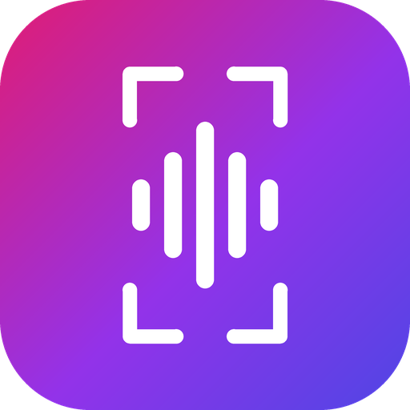
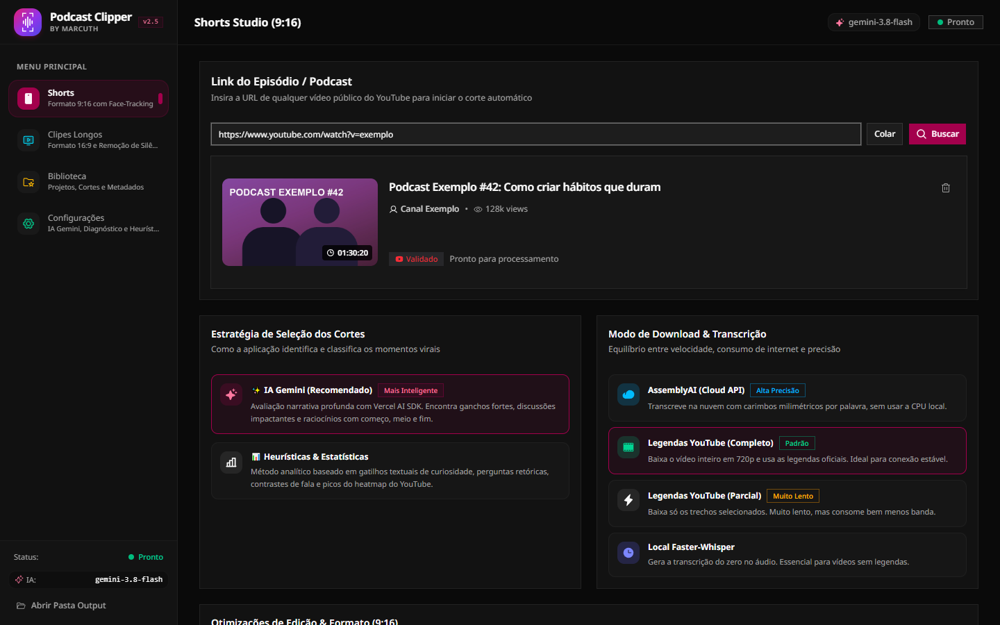
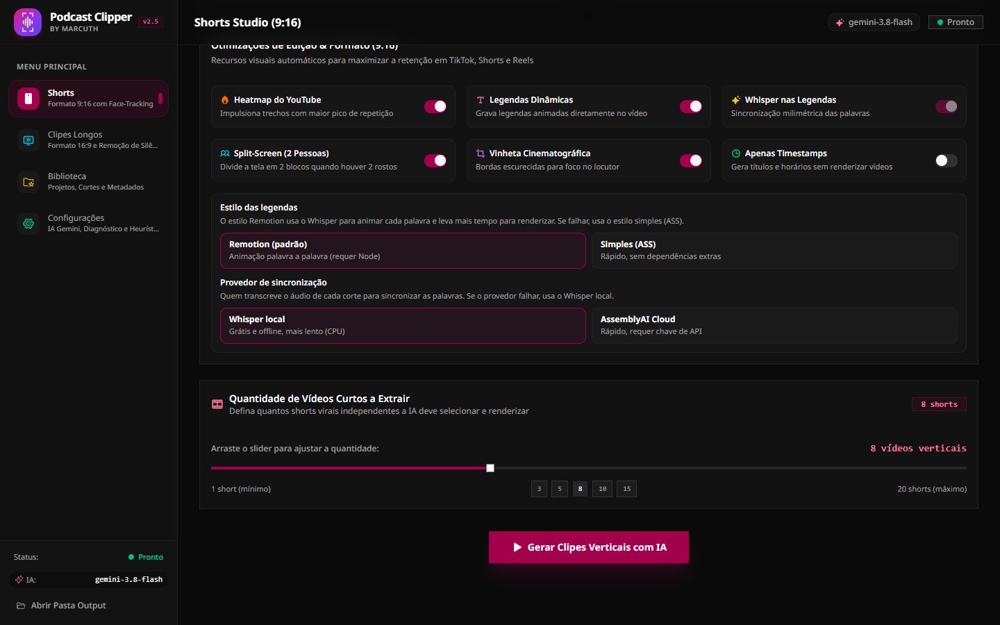
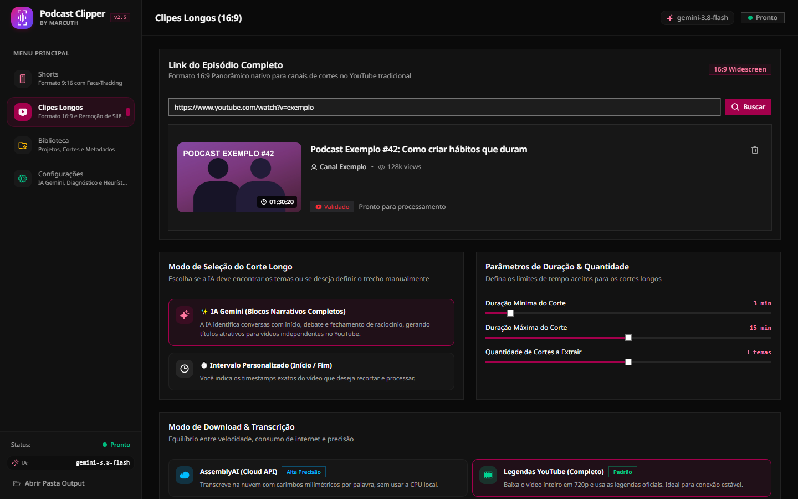
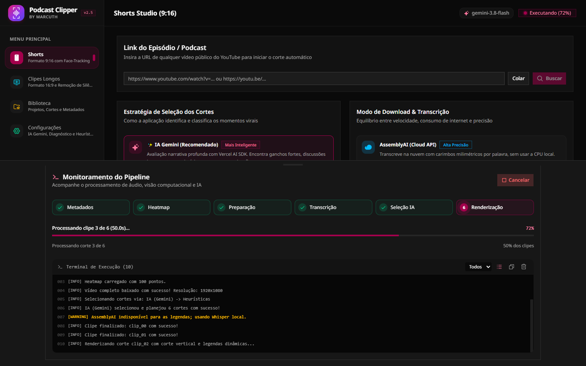
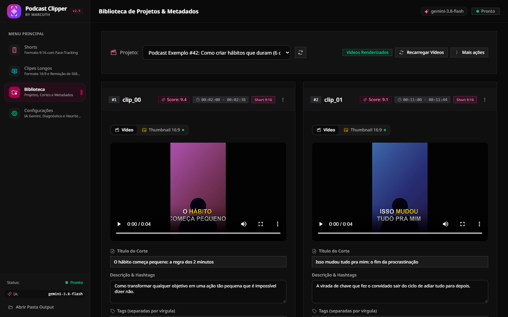
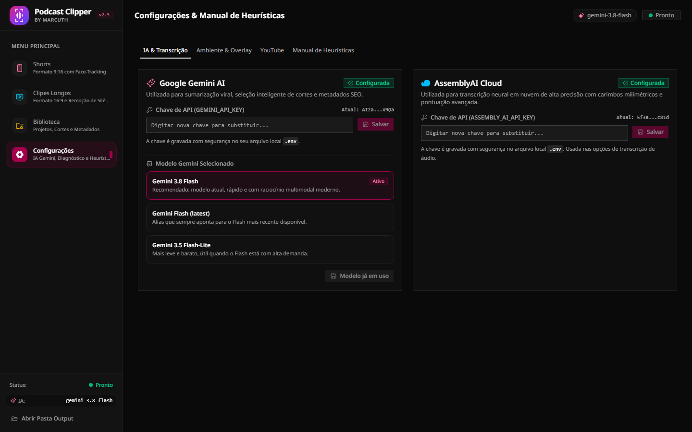
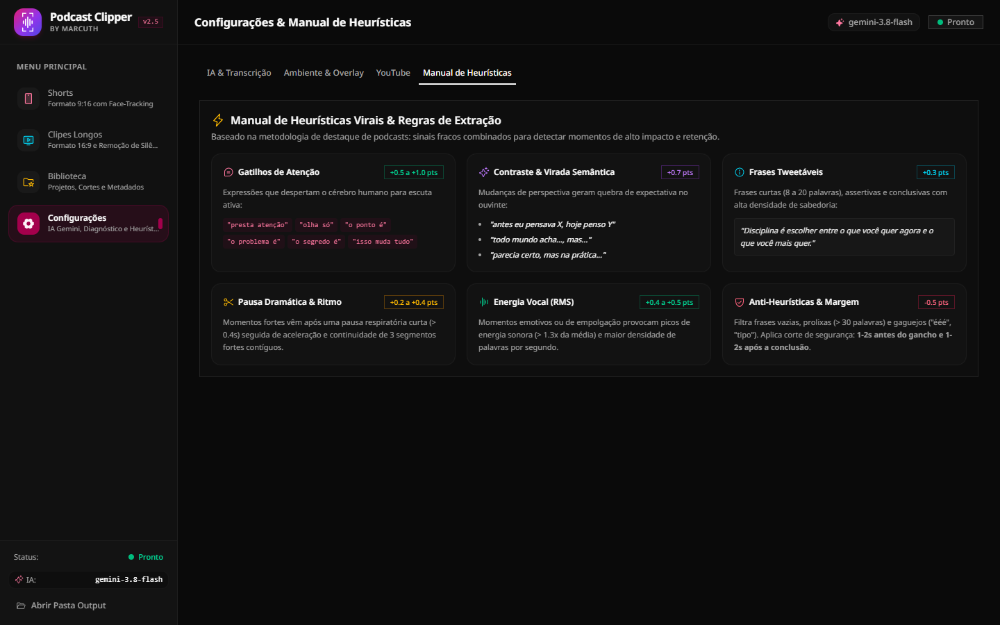

<p align="center">
  
</p>

# Podcast Clipper

**Transforme um podcast do YouTube em dezenas de cortes prontos para postar.** Cole o link do episódio, escolha como quer os cortes e o Podcast Clipper encontra os melhores momentos, enquadra o rosto de quem fala, coloca legendas animadas e ainda escreve título, descrição e hashtags para cada corte.

- **Shorts verticais (9:16)** para TikTok, Reels e YouTube Shorts, com legendas palavra por palavra.
- **Cortes longos (16:9)** para o YouTube tradicional, com remoção automática de silêncios.
- **Só timestamps e metadados**, se você prefere editar à mão no Premiere, CapCut ou DaVinci.



> As imagens deste guia usam dados de exemplo (um podcast fictício) para mostrar cada tela.

---

## Como funciona

1. **Cole o link** do episódio no YouTube.
2. **Escolha** como selecionar os cortes, de onde vem a transcrição e quais efeitos quer.
3. **Clique em gerar** e acompanhe o progresso. Os cortes aparecem na Biblioteca, prontos para revisar, editar e publicar.

---

## Conheça as telas

### Shorts Studio: cortes verticais 9:16

Aqui você cria os vídeos curtos. Cole o link, clique em **Buscar** e o app mostra o vídeo encontrado (capa, canal, duração e visualizações) para você confirmar antes de gastar tempo processando.

Logo abaixo, duas escolhas principais:

- **Estratégia de seleção dos cortes**
  - **IA Gemini (recomendada):** a IA lê a transcrição inteira e procura ganchos fortes, viradas de raciocínio e conclusões.
  - **Heurísticas e estatísticas:** regras de palavras-chave, perguntas, pausas e os trechos mais reproduzidos do YouTube. Funciona sem chave de IA.
- **Modo de download e transcrição**
  - **AssemblyAI (nuvem):** rápido e preciso, usa um serviço online.
  - **Legendas do YouTube (completo ou parcial):** usa as legendas oficiais do vídeo. O modo parcial baixa só os trechos dos cortes, gasta menos internet, mas é bem mais lento.
  - **Whisper local:** transcreve no seu computador. Ideal para vídeos sem legendas.

### Opções de edição e geração



Mais abaixo, você liga e desliga cada efeito:

| Opção | O que faz |
|---|---|
| **Heatmap do YouTube** | Dá mais peso aos trechos que o público mais reviu |
| **Legendas dinâmicas** | Queima no vídeo legendas animadas, palavra por palavra |
| **Whisper nas legendas** | Re-transcreve cada corte para sincronizar as palavras com precisão |
| **Split-screen (2 pessoas)** | Divide a tela em dois blocos quando há dois rostos na cena |
| **Vinheta cinematográfica** | Escurece as bordas para focar em quem fala |
| **Apenas timestamps** | Gera títulos e horários sem renderizar vídeo (rápido) |

No quadro de legendas você escolhe o **estilo**, **Remotion** (animação palavra a palavra, exige Node.js) ou **Simples (ASS)** (rápido e sem dependências extras), e o **provedor de sincronização**: **Whisper local** (grátis, mais lento) ou **AssemblyAI** (rápido, exige chave). Se o provedor escolhido falhar, o app usa o Whisper local automaticamente.

Por fim, use o controle deslizante para definir quantos shorts extrair e clique em **Gerar Clipes Verticais**.

### Clipes Longos: cortes horizontais 16:9



Para recortar temas completos (de 3 a 20 minutos) do episódio:

- **IA Gemini:** encontra blocos fechados, com começo, debate e conclusão.
- **Intervalo personalizado:** você informa o início e o fim exatos (`HH:MM:SS`).
- **Duração mínima, máxima e quantidade** de cortes ajustáveis por controles deslizantes.
- **Remoção de silêncios (jump cut)** e **overlay** opcional (moldura ou marca d'água em PNG/JPG sobre o vídeo).

### Monitor do pipeline



Ao iniciar, uma gaveta se abre na parte de baixo da tela mostrando:

- as **seis etapas** (Metadados, Heatmap, Preparação, Transcrição, Seleção e Renderização) e qual está rodando;
- a **barra de progresso** e quantos cortes já foram feitos;
- o **terminal de execução** com os avisos e erros em cores. Dá para filtrar, copiar e limpar o log.

Precisa parar? Clique em **Cancelar**: o processamento termina com segurança ao fim da etapa atual.

### Biblioteca: revise, edite e publique



Todos os projetos já gerados ficam aqui. Escolha um projeto e, para cada corte, você pode:

- **assistir** ao vídeo e ver a nota de potencial viral (*score*) e o intervalo no episódio original;
- **editar** título, descrição e hashtags, e clicar em **Salvar alterações**;
- **enviar ao YouTube** direto do app (depois de configurar o canal);
- usar o menu **⋮** para **aplicar legendas** num corte já pronto, **re-renderizar**, **abrir no player externo**, **gerar a thumbnail** e **copiar os metadados**;
- filtrar por formato (shorts ou cortes longos) e, em **Mais ações**, excluir o projeto.

No modo "apenas timestamps", o corte aparece com o botão **Renderizar vídeo agora**, para gerar o vídeo só dos que você aprovar.

### Configurações



Aqui você cola suas chaves de API (elas ficam salvas no arquivo `.env`, no seu computador), escolhe o **modelo do Gemini**, define o **overlay padrão** dos cortes longos e conecta o **canal do YouTube** para publicar.



A aba **Manual de Heurísticas** explica, em linguagem simples, como o app pontua os momentos quando você não usa IA: gatilhos de atenção, contraste, frases tweetáveis, pausa dramática, energia da voz e filtros contra trechos vazios.

---

## Baixar o app (sem instalar nada)

Na página de [**Releases**](https://github.com/marcuth/podcast-clipper/releases) há um arquivo para cada sistema. Baixe, extraia e abra:

| Sistema | Arquivo | Como abrir |
|---|---|---|
| **Windows 10/11** | `PodcastClipper-windows-x64.zip` | Extraia e execute `PodcastClipper.exe` |
| **macOS (Apple Silicon)** | `PodcastClipper-macos-arm64.zip` | Extraia e abra `PodcastClipper.app`* |
| **Linux (64 bits)** | `PodcastClipper-linux-x64.tar.gz` | Extraia e execute `./PodcastClipper/PodcastClipper` |

O FFmpeg já vai dentro do app. Suas chaves de API, o `.env` e a pasta `output/` ficam ao lado do executável (Windows e Linux) ou em `~/PodcastClipper` (macOS). Para as legendas animadas estilo Remotion, instale o [Node.js](https://nodejs.org/); sem ele o app usa o estilo simples.

\* O app ainda não é assinado. No macOS, na primeira vez, clique com o botão direito em `PodcastClipper.app`, escolha **Abrir** e confirme. No Windows, se o SmartScreen avisar, clique em **Mais informações → Executar assim mesmo**. No Linux, o app usa Qt e pode pedir bibliotecas do sistema (`libxcb-cursor0`, `libnss3`).

Se preferir rodar pelo código-fonte, siga a instalação abaixo.

---

## Instalação pelo código-fonte

### O que você precisa

| Item | Para quê | Obrigatório |
|---|---|---|
| **Windows 10/11** | Interface desktop | Sim |
| **Python 3.12** e **[Poetry](https://python-poetry.org/docs/#installation)** | Rodar o app | Sim |
| **[FFmpeg](https://ffmpeg.org/download.html)** no PATH | Cortar e renderizar vídeos | Sim |
| **Node.js** | Legendas animadas estilo Remotion | Recomendado |
| Chave do **[Google Gemini](https://aistudio.google.com/)** | Seleção de cortes e metadados por IA | Recomendado |
| Chave da **[AssemblyAI](https://www.assemblyai.com/)** | Transcrição rápida na nuvem | Opcional |

Sem a chave do Gemini, o app usa as heurísticas. Sem a da AssemblyAI, usa as legendas do YouTube ou o Whisper local. Sem o Node, as legendas Remotion caem para o estilo simples.

### Passo a passo

```bash
# 1. Baixe o projeto e entre na pasta
cd podcast-clipper

# 2. Instale as dependências
poetry install

# 3. Monte a interface (só na primeira vez)
cd client
npm install
npm run build
cd ..

# 4. Crie o arquivo de configuração
cp .env.example .env

# 5. Abra o app
poetry run gui
```

Na primeira execução, abra **Configurações** e cole sua chave do Gemini (e a da AssemblyAI, se for usar). Também dá para editar o `.env` direto. Na primeira vez que o Whisper local for usado, ele baixa o modelo, o que pode levar alguns minutos.

---

## Onde ficam os resultados

Tudo vai para a pasta `output/`, uma subpasta por episódio:

```
output/
└── nome-do-episodio/
    ├── timestamps.txt        # lista legível: início, fim, título, descrição e tags de cada corte
    ├── timestamps.json       # os mesmos dados, para outros programas
    └── clips/
        ├── clip_00.mp4       # short renderizado
        ├── clip_00_details.json   # título, descrição, tags e gancho
        ├── long_00.mp4       # corte longo (se você gerou)
        └── ...
```

Dica: o botão **Abrir pasta output**, no canto da barra lateral, abre essa pasta no Explorador de Arquivos.

---

## Prefere o terminal?

O mesmo pipeline roda por linha de comando, com um assistente de perguntas ou totalmente automático:

```bash
poetry run start                              # assistente interativo
poetry run start URL --yes                    # usa os padrões, sem perguntas
poetry run start URL -y --format long --max-clips 3
```

Veja todas as opções em [docs/CLI.md](docs/CLI.md).

---

## Problemas comuns

| Sintoma | Solução |
|---|---|
| "Vídeos não renderizam" | Instale o FFmpeg e confirme que `ffmpeg -version` funciona no terminal |
| A seleção por IA não roda | Falta a chave do Gemini em **Configurações**; o app cai para as heurísticas |
| A AssemblyAI não é usada | Falta a chave; o app usa o Whisper local (mais lento) |
| As legendas ficaram simples | O Node.js não está instalado; o app usou o estilo ASS como alternativa |
| A tela abre em branco | Rode `npm run build` dentro de `client/` e abra o app de novo |
| Erro 429 do Gemini | Limite de uso da API; espere um pouco ou troque o modelo em **Configurações** |

---

## Para desenvolvedores

```bash
poetry run gui:dev      # app com a interface em modo de desenvolvimento (HMR)
```

A documentação técnica está em [`docs/`](docs/INDEX.md): [arquitetura](docs/ARCHITECTURE.md), [pipeline](docs/PIPELINE.md), [heurísticas](docs/HEURISTICS.md), [serviço Gemini](docs/GEMINI_SERVICE.md), [processamento de vídeo](docs/VIDEO_PROCESSING.md), [frontend](docs/FRONTEND.md) e [configuração e `.env`](docs/CONFIG_AND_ENV.md). Contribuições seguem commits convencionais (`feat:`, `fix:`, `docs:`...).

---

### Publicar uma versão (binários automáticos)

Ao **publicar uma release** no GitHub, o workflow [`release.yml`](.github/workflows/release.yml) compila o app para Windows, macOS e Linux e anexa os arquivos à própria release (leva cerca de 20 a 40 minutos).

1. Atualize a versão, faça o commit e crie a tag: `git tag v1.0.0 && git push origin v1.0.0`.
2. No GitHub, vá em **Releases → Draft a new release**, escolha a tag e clique em **Publish release**.
3. Acompanhe em **Actions → Release binaries**. Se um sistema falhar, use **Run workflow** informando a tag para refazer.

Para gerar o app na sua máquina: `cd client && npm run build`, depois `poetry run pip install pyinstaller` e `poetry run python scripts/build_app.py --package`.

---

## Licença e créditos

MIT. Veja [`LICENSE`](LICENSE).

Construído com [MediaPipe](https://github.com/google-ai-edge/mediapipe), [Faster-Whisper](https://github.com/SYSTRAN/faster-whisper), [Google Gemini](https://ai.google.dev/), [AssemblyAI](https://www.assemblyai.com/), [yt-dlp](https://github.com/yt-dlp/yt-dlp), [MoviePy](https://zulko.github.io/moviepy/), [FFmpeg](https://ffmpeg.org/), [Remotion](https://www.remotion.dev/), React, Tailwind, Shadcn/ui e PyWebView.
